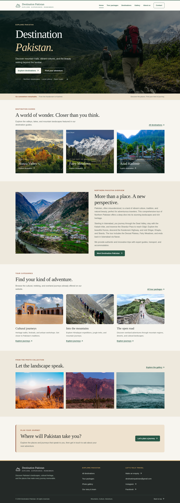
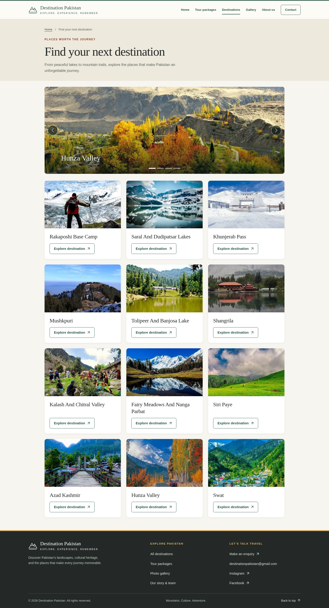
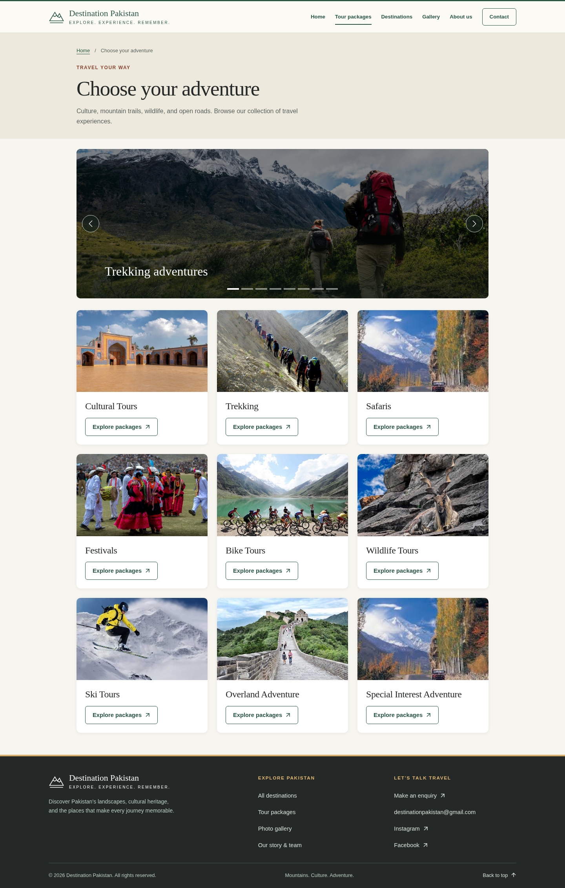
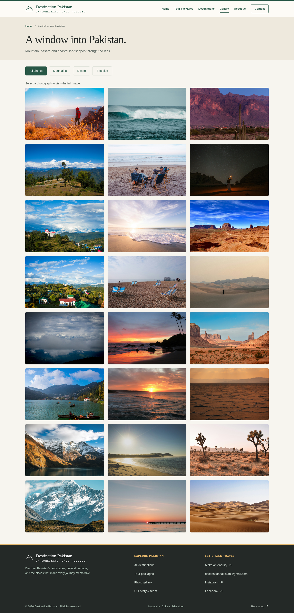

# Destination Pakistan

Explore Pakistan’s mountain trails, quiet lakes, cultural landmarks, and coastal landscapes. Destination Pakistan is a responsive tourism website showcasing destinations and travel experiences across the country.

## Live Demo

Explore Destination Pakistan online:

[**Visit Destination Pakistan**](https://aymenmansoor.github.io/Destination-Pakistan/)

## Overview

Discover places to visit, read individual destination guides, and browse tour packages spanning culture, trekking, wildlife, and other adventures. Photographs and practical travel information help visitors explore their options and prepare an enquiry.

## Features

- Destination directory and twelve individual travel guides.
- Nine tour categories with package descriptions, durations, and listed prices.
- Interactive photo gallery with category filters and a keyboard-accessible image viewer.
- Responsive navigation and layouts for desktop, tablet, and mobile.
- Image slideshows with automatic transitions and manual controls.
- Subtle scroll and hover animations, with reduced-motion support.
- Contact enquiry interface with tour subject prefilling, email drafts, and clipboard copying.

The contact interface prepares an enquiry for the visitor to send through their own email application. It does not send or store messages, create bookings, or process payments. Confirm current package prices, availability, and travel conditions before making plans.

## Technologies

- HTML5
- CSS3
- JavaScript
- Bootstrap 5.0.2, bundled locally with its MIT license

The website uses system fonts and requires no framework, backend, database, or build step.

## Getting Started

Clone the repository:

```sh
git clone https://github.com/aymenmansoor/Destination-Pakistan.git
cd Destination-Pakistan
```

Alternatively, select **Code → Download ZIP** on GitHub and extract the archive.

Open `index.html` in your browser to view the website. Keep the project folders together so images, styles, and scripts load correctly.

For local development, an optional local server provides more reliable clipboard access. With Python 3 already installed, run this command from the project folder:

```sh
python3 -m http.server 8000 --bind 127.0.0.1
```

Then open localhost on port 8000 in your browser. Press Ctrl+C to stop the server. No package installation is needed to run the website. Opening an email draft requires a configured email application; clipboard access depends on browser permissions.

## Project Structure

```text
Destination-Pakistan/
├── index.html              # Homepage
├── front.html              # Alternate homepage route
├── destination.html        # Destination directory
├── tour.html               # Tour package directory
├── gallery.html            # Interactive photo gallery
├── about.html              # Story and team
├── contact.html            # Enquiry interface
├── …                       # Destination guides and tour category pages
├── assets/
│   ├── css/                # Shared styles and responsive layouts
│   ├── js/                 # Navigation, slideshows, gallery, and animations
│   ├── vendor/bootstrap/   # Local Bootstrap files and license
│   └── favicon.svg
├── destinations/           # Destination photographs
├── tour/                   # Tour and team photographs
├── kashmir/                # Mountain gallery photographs
├── desert/                 # Desert gallery photographs
├── Sea Side/               # Coastal gallery photographs
├── screenshots/            # Website screenshots
└── scripts/                # Optional development verification tools
```

Edit page content directly in the HTML files. Shared styles load through `assets/css/site.css`. Keep `index.html` and `front.html` synchronized, and preserve filename capitalization and spaces when updating links.

## Screenshots

### Homepage



### Destinations



### Tour Packages



### Gallery


